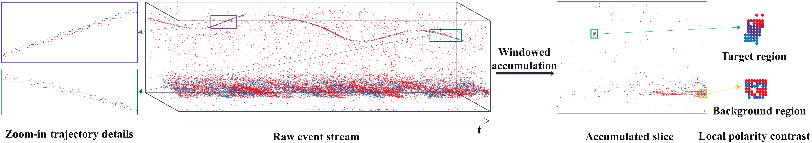
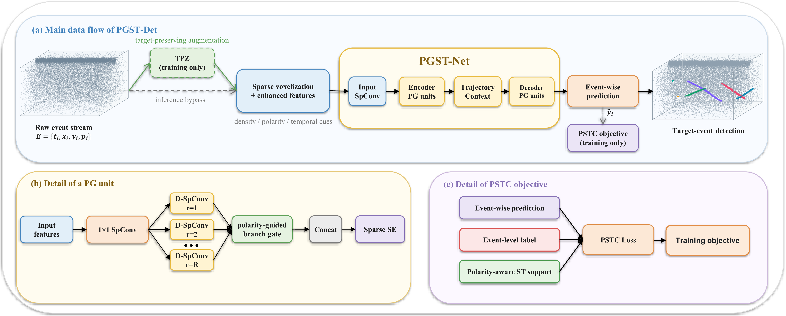
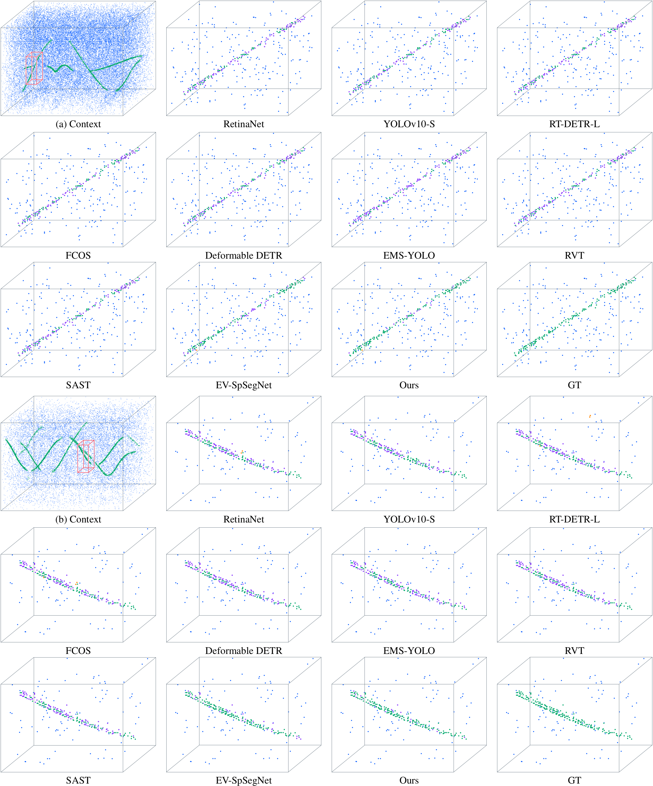

<h1>Beyond Continuity: Polarity-Conditioned Spatiotemporal Support for Event-Based Tiny Aerial Target Detection</h1>

Xiucheng Wang1, Hongguang Li1,&#8224;, Xinjun Li2, Wenhu Fan2

1Institute of Unmanned Systems, Beihang University 
2School of Mechanical Engineering and Automation, Beihang University

(&#8224; corresponding author)

Submitted to <i>Chinese Journal of Aeronautics (CJA)</i>

## 📖 Abstract

Tiny aerial targets appear as sparse, fragmented trajectories in event streams, making their detection highly dependent on spatiotemporal associations among limited responses. However, background motion can also produce coherent structures, so stronger continuity does not necessarily improve target discrimination. We propose PGST-Det, a polarity-guided sparse trajectory learning framework that extends neighborhood confidence aggregation to polarity-conditioned spatiotemporal support. Its central principle is to use spatiotemporal proximity to define the support neighborhood and local polarity relationships to regulate support strength. Specifically, PGST-Det combines all-polarity support with prediction-confidence support from same-polarity neighbors and further adjusts the resulting weights according to local polarity-composition consistency. These weights guide event-level supervision. Combined with multiscale sparse features that retain polarity and temporal information, this formulation allows neighborhoods with similar aggregate confidence but different polarity organization to receive different supervisory weights, without requiring a target trajectory to have a single polarity. Experiments on benchmark event datasets show IoU improvements of 10.96 and 13.99 percentage points over a representative sparse event-based method on the primary benchmark and under frozen-weight cross-dataset transfer with target-domain threshold calibration, respectively. The false-alarm rate is reduced by 95.2% on the primary benchmark. Under the tested synthetic background-event noise, PGST-Det also maintains higher IoU and lower false-alarm rates than this reference method.

**Keywords:** Event cameras; Tiny aerial target detection; Event-level segmentation; Polarity-conditioned supervision; Sparse spatiotemporal learning.

## 🧠 Method

PGST-Det operates directly on sparse asynchronous measurements and returns an event-wise target probability. Spatiotemporal proximity defines the support neighborhood, while local polarity relationships regulate support strength for event-level supervision. Training-time augmentation and supervision are removed during inference.

| Component | Description |
|---|---|
| **PTVE** | Enriches occupied voxels with event density, polarity composition, and temporal-distribution statistics. |
| **PGST-Net** | Organizes fragmented trajectories through multiscale sparse convolutions and polarity-informed branch gating. |
| **PSTC** | Combines all-polarity support with same-polarity prediction-confidence support and local polarity-composition consistency to weight event-level supervision. |
| **TPZ** | Applies label-conditioned crop-and-zoom augmentation while preserving scarce target-event evidence. |

## 📊 Results

The values below follow the current manuscript protocol and cover frame-based, SNN/event-frame, voxel-based, and sparse-event methods. **ACC** follows the EV-UAV benchmark notation and measures target-event recall rather than background-dominated global accuracy. Lower **Fa** is better. Bold and underlined values indicate the best and second-best results, respectively.

### EV-UAV

EV-SpSegNet and PGST-Det are reported as matched three-run means; the reproduced external methods use one checkpoint per method.

| Method | Event Representation | IoU (%) ↑ | ACC (%) ↑ | Pd (%) ↑ | Fa (10-4) ↓ |
|---|---|---:|---:|---:|---:|
| SSD300 | Event count | 27.26 | 27.61 | 49.77 | **0.05** |
| Faster R-CNN | Event count | 33.67 | 40.34 | 86.51 | 2.53 |
| DETR | Event count | 33.85 | 40.66 | 88.94 | 1.82 |
| RetinaNet | Event count | 35.13 | 37.13 | 73.60 | 0.23 |
| YOLOv10-S | Event count | 35.17 | 36.98 | 75.77 | 0.19 |
| YOLO11-S | Event count | 36.59 | 37.25 | 77.01 | <u>0.06</u> |
| RT-DETR-L | Event count | 36.49 | 40.29 | 89.27 | 0.55 |
| FCOS | Event count | 36.99 | 40.98 | 87.91 | 0.61 |
| Deformable DETR | Event count | 38.70 | 40.17 | 85.21 | 0.18 |
| EMS-YOLO | SNN/event frames | 31.33 | 31.80 | 87.82 | **0.05** |
| RVT | Voxel grid | 38.46 | 39.54 | **95.75** | 0.10 |
| SAST | Voxel grid | 37.35 | 38.74 | <u>95.37</u> | 0.14 |
| EV-SpSegNet | Sparse events | <u>53.41</u> | **70.87** | 82.84 | 13.531 |
| **PGST-Det** | Polarity-guided sparse events | **64.37** | <u>69.12</u> | 78.00 | 0.646 |

PGST-Det achieves the highest event-level IoU on EV-UAV. Across three training runs, its IoU is **(64.37 ± 1.99)%**, compared with **(53.41 ± 8.70)%** for EV-SpSegNet (mean ± standard deviation). The **10.96-percentage-point** gain in mean IoU is accompanied by a **95.2%** reduction in mean Fa: **0.646 ± 0.374** versus **13.531 ± 12.415**, in the table's units.

RVT and SAST detect more than 95% of annotated target intervals, while each retains fewer than 40% of the target events. PGST-Det retains **69.12%** of target events and detects **78.00%** of target intervals.

### EV-Flying Bird/Insect

Model weights remain fixed after source-domain training on EV-UAV, and thresholds are selected on the target-domain validation split. The evaluation uses source-sequence-disjoint splits.

| Method | Event Representation | IoU (%) ↑ | ACC (%) ↑ | Pd (%) ↑ | Fa (10-4) ↓ |
|---|---|---:|---:|---:|---:|
| SSD300 | Event count | <u>17.94</u> | 22.28 | 41.22 | 11.429 |
| Faster R-CNN | Event count | 11.56 | 14.93 | <u>51.75</u> | 6.253 |
| DETR | Event count | 9.97 | 12.64 | 39.91 | 2.966 |
| RetinaNet | Event count | 10.96 | 12.63 | 30.12 | 1.634 |
| YOLOv10-S | Event count | 10.93 | 13.12 | 37.09 | 2.066 |
| YOLO11-S | Event count | 11.99 | 15.21 | 47.81 | 3.330 |
| RT-DETR-L | Event count | 9.56 | 11.11 | 34.15 | <u>1.502</u> |
| FCOS | Event count | 10.31 | 12.27 | 34.51 | 1.973 |
| Deformable DETR | Event count | 11.54 | 14.09 | 33.38 | 2.575 |
| EMS-YOLO | SNN/event frames | 6.92 | 11.06 | 29.38 | 28.062 |
| RVT | Voxel grid | 11.48 | 13.55 | 44.44 | 3.602 |
| SAST | Voxel grid | 11.65 | 12.08 | 35.25 | **0.405** |
| EV-SpSegNet | Sparse events | 17.31 | <u>46.08</u> | 23.43 | 134.784 |
| **PGST-Det** | Polarity-guided sparse events | **31.30** | **73.13** | **58.91** | 266.792 |

PGST-Det obtains the highest IoU, ACC, and Pd, exceeding EV-SpSegNet by **13.99**, **27.05**, and **35.48 percentage points**, respectively. Its Pd of **58.91%** is also **7.16 percentage points** higher than that of Faster R-CNN. At this operating point, PGST-Det retains more annotated target events and detects more target intervals. The corresponding Fa values are **266.792** for PGST-Det and **134.784** for EV-SpSegNet, in the table's units.

### Qualitative Comparison

The EV-UAV examples below contain cluttered and sparse tiny-target trajectories. PGST-Det retains the dominant target support while removing a larger portion of isolated background responses.

  

## 🔧 Usage

This repository accompanies the CJA submission. The reproducible implementation will be published here upon acceptance and will include:

- [ ] Source code for PGST-Det
- [ ] Environment and dependency specification
- [ ] Training and evaluation configurations
- [ ] Pretrained checkpoints
- [ ] Dataset preparation utilities
- [ ] Scripts for reproducing the principal tables and figures

Commands in this section will be added together with the implementation so that the documented interface matches the released code.

## 🎨 Preparing Datasets

### EV-UAV

[EV-UAV](https://arxiv.org/abs/2506.23575) is the primary benchmark. It contains 147 sequences with event-level binary annotations and predefined 99/24/24 training, validation, and test splits. The release will include preprocessing and evaluation instructions without redistributing the dataset itself.

### EV-Flying Bird/Insect

[EV-Flying](https://doi.org/10.1109/CVPRW67362.2025.00487) provides temporally indexed bounding boxes for in-the-wild flying objects. Our protocol derives event-level labels from the bird/insect boxes and uses source-sequence-disjoint training, validation, and test subsets. The exact split manifest and conversion utility will accompany the code release.

## 💻 Training

The release will provide the complete configurations used for the matched EV-UAV repetitions and EV-Flying frozen-weight evaluation. Configuration files will record optimization, augmentation, checkpoint selection, and validation-threshold selection settings.

Training commands will be documented after the implementation is public.

## ✨ Evaluation

The evaluation package will report event-level IoU, benchmark ACC, Pd, and Fa under the protocols described in the manuscript. It will also include the low-false-alarm threshold sweep, synthetic-noise evaluation, and sequence-level efficiency measurement.

Evaluation commands and expected output files will be documented with the release.

## 🎫 License

A source-code license will be added when the implementation is released. At present, this repository contains project documentation and representative paper figures only.

## ⭐ BibTeX

The canonical BibTeX entry will be added when a public preprint or published article becomes available.

## 📧 Contact

For project-related questions, please open a GitHub issue. Implementation-specific support will begin with the code release.

## 🙏 Acknowledgements

This work builds on the event-level tiny-object detection setting and EV-SpSegNet baseline introduced with EV-UAV. We thank the authors of EV-UAV and EV-Flying for making their research resources available to the community.
